# modelbot-cli

`modelbot` 是 ROCm llama.cpp 优化赛（[rocm-challenge.amddev.ai](https://rocm-challenge.amddev.ai/)）的选手命令行工具：用 GitHub 账号注册，提交针对 llama.cpp 的补丁，查看评测结果和排行榜。

- 题面：[`problem/problem1_EN_navi3.md`](https://github.com/Kaihui-AMD/modelbot-cli/blob/main/problem/problem1_EN_navi3.md)
- 网页排行榜：https://rocm-challenge.amddev.ai/
- 示例补丁：[`examples/noop.patch`](https://github.com/Kaihui-AMD/modelbot-cli/blob/main/examples/noop.patch)，只加了一行注释，可以用来先走通提交流程

## 目录

- [评测流程](#评测流程)
- [1. 安装](#1-安装)
- [2. 用 GitHub 账号注册](#2-用-github-账号注册)
- [3. 查看题目](#3-查看题目)
- [4. 制作补丁](#4-制作补丁)
- [5. 先用 test 模式验证](#5-先用-test-模式验证编译和精度约-8-分钟)
- [6. 正式提交：leaderboard 模式](#6-正式提交leaderboard-模式编译精度性能约-14-分钟)
- [7. 没通过时会看到什么](#7-没通过时会看到什么)
- [8. 排队、查询与取消](#8-排队查询与取消)
- [9. 历史提交、日志与补丁](#9-历史提交日志与补丁)
- [10. 排行榜](#10-排行榜)
- [11. 状态和结果怎么看](#11-状态和结果怎么看)
- [命令速查](#命令速查)

## 评测流程

补丁提交后进入队列，轮到时在评测机的一张 AMD Radeon PRO W7900D（ROCm 10.0）上依次经过四道关，任何一关不通过就结束：

| 关卡 | 内容 | 不通过时的结果 |
|---|---|---|
| 补丁 | `git apply --check` 能打到基准 commit `aa39d7a3` 上；只改 `ggml/`、`src/`；不超过 1 MiB；不含二进制、符号链接或子模块 | 预检直接拒绝（不排队） |
| 编译 | 在预编译好的源码树上增量编译 `llama-bench`、`llama-perplexity`、`llama-tokenize`（Release，`GGML_HIP=ON`，gfx1100），并检查编译选项没被改动 | `failed` / `build_failed` |
| 精度 | 三组 `llama-perplexity`（wikitext-2 test，chunk 数固定），每组 PPL 与未修改版本的偏差都在 ±5% 以内 | `succeeded` / `accuracy_failed` |
| 性能（仅 leaderboard 模式） | 题面 Case 1（3 项）和 Case 2（2 项）的 `llama-bench`。分数是五项 ROCm 吞吐与 Vulkan 基线之比的几何平均，五项都快过 Vulkan 才算 qualified | `succeeded` / `below_vulkan` |

评测结果写入服务端并计入排行榜。

## 1. 安装

CLI 是纯 Python 程序（Python 3.9 及以上，依赖 `requests`、`pyyaml`）：

```bash
pip install git+https://github.com/Kaihui-AMD/modelbot-cli
modelbot --version
modelbot --help
```

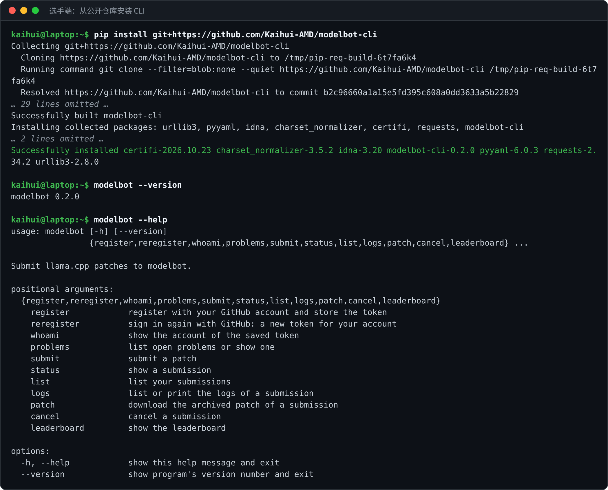

升级到最新版：`pip install --upgrade git+https://github.com/Kaihui-AMD/modelbot-cli`。

## 2. 用 GitHub 账号注册

不需要邀请码，用自己的 GitHub 账号注册即可。modelbot 账号和 GitHub 账号一一对应，用户名就是 GitHub 用户名：

```bash
modelbot register github                # 第一次注册
modelbot register github --no-browser   # 没有图形界面时只打印授权链接
modelbot reregister github              # 换电脑或丢了配置时，给同一个账号换一个新 token
modelbot whoami                         # 查看当前 token 对应的账号
```

`register` 会打开浏览器进入 GitHub 的授权页（加 `--no-browser` 时只打印链接）。点击授权后，浏览器跳回 modelbot，页面显示 "Signed in to modelbot"，CLI 随即提示注册成功。API 地址和 token 保存在 `~/.modelbot.yaml`（权限 600）。下图是在一台没有浏览器的机器上注册，授权链接复制到另一台电脑的浏览器里打开：


授权后浏览器里显示的页面：

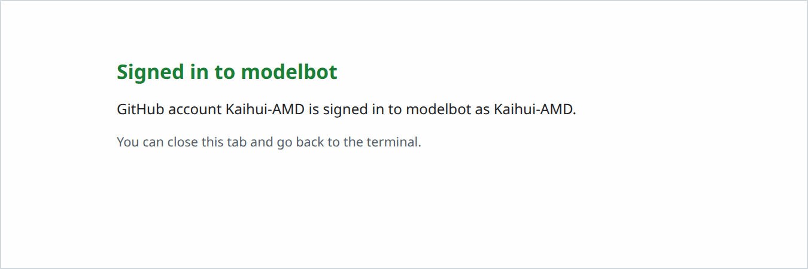

- 打开授权页之前 token 就已经写进配置，授权完成后才生效。中途在终端按 Ctrl-C 也没关系，网页上授权完成后照样能用。
- 已经注册过的 GitHub 账号再 `register` 会提示改用 `reregister`。`reregister` 换上新 token 后，旧 token 立即失效。
- 授权链接可以复制到任何一台电脑的浏览器里打开（比如在没有图形界面的 GPU 服务器上注册），只要那台电脑能访问 https://rocm-challenge.amddev.ai ，因为 GitHub 授权后会把浏览器跳回这个地址。
- modelbot 不申请任何 GitHub 权限，只读取公开的用户 ID 和用户名，也不保存 GitHub 的 token。账号按 GitHub 用户 ID 识别，GitHub 改名后 `reregister` 一次，用户名会跟着更新。

CLI 默认连接 `https://rocm-challenge.amddev.ai`，不用传 `--api`。可以用 `MODELBOT_CONFIG` 指定别的配置文件，也可以用环境变量 `MODELBOT_API_URL`、`MODELBOT_TOKEN` 覆盖配置。

## 3. 查看题目

```bash
modelbot problems                      # 当前开放的题目
modelbot problems llamacpp-navi3-p1    # 题目详情
```


题目详情里包括：基准 commit、评测镜像（按 digest 固定）、允许修改的路径、三组 PPL 的参考值和固定的 chunk 数，以及五项 benchmark 的 Vulkan 基线。

## 4. 制作补丁

```bash
git clone https://github.com/ggml-org/llama.cpp && cd llama.cpp
git checkout aa39d7a3e145a88202793a89462d65e94a5fc25f
# 只修改 ggml/ 和 src/ 下的文件
git diff > ../my.patch
```

补丁必须是一个针对基准 commit 的 unified diff（`git diff` 的输出）。提交前 CLI 会在本地检查路径和大小；加上 `--base <llama.cpp 目录>` 时还会在本地跑一次 `git apply --check`。想先走通流程，可以直接提交示例补丁：`modelbot submit examples/noop.patch --mode test`。

越界的补丁在本地预检就被拒绝。即使绕过 CLI 直接调 API，服务端也会做同样的检查：

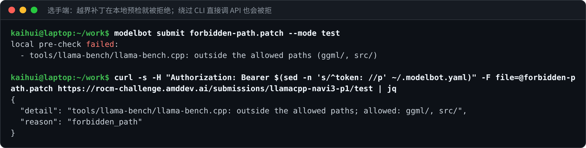

## 5. 先用 test 模式验证（编译和精度，约 8 分钟）

```bash
modelbot submit my.patch --mode test
```

CLI 每 10 秒查询一次状态，状态有变化就打印一行（排队等 GPU、开始评测、出结果），最后打印结果报告：

- 每道关的结果和耗时；
- 三组 PPL 的实测值、参考值和比值；
- 评测用的 GPU。

下图是一个 test 提交的结果报告。`modelbot status <编号>` 随时可以再看这份报告，内容和 `submit` 等到最后打印的一样：

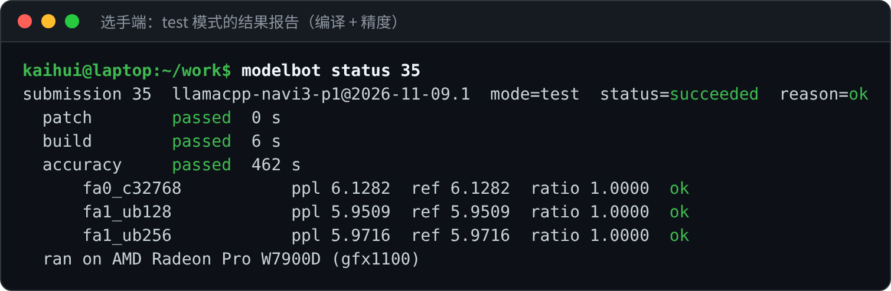

test 模式不跑性能测试，也不进排行榜。进度行里的 `running (build, accuracy, performance)` 是所有模式共用的提示文字。

## 6. 正式提交：leaderboard 模式（编译、精度、性能，约 14 分钟）

```bash
modelbot submit my.patch          # 默认就是 --mode leaderboard
```


性能部分每项显示：ROCm 实测吞吐（tokens/s）、Vulkan 基线、两者之比、是否更快，以及多次重复测量的变异系数（cv）。`score` 是五项比值的几何平均，越高越好；`qualified=True` 要求五项都快过 Vulkan。截图里是未修改的代码（`noop.patch` 只加了一行注释），分数为 0.8575，五项中只有 `pp4096-ub256-fa1` 快过 Vulkan（×1.097）。

## 7. 没通过时会看到什么

编译失败时显示编译器报错；精度超差时显示超差的那组 PPL，后面几组不再跑：

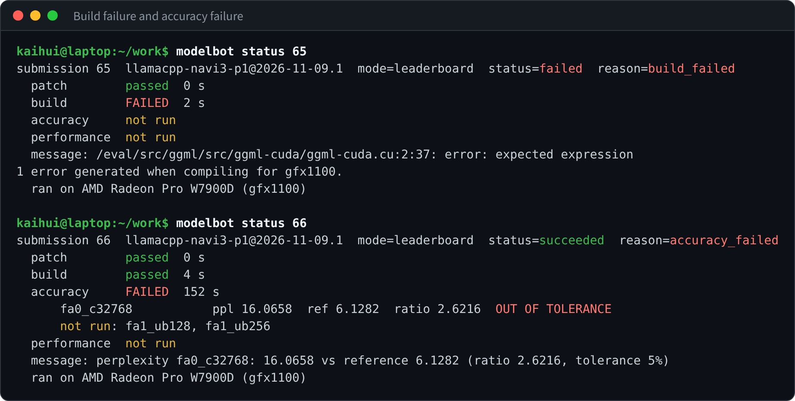

某个阶段超过时间预算（编译 900 秒、精度三组合计 1200 秒、性能两条合计 900 秒）时，评测结束，结果是 `timeout`（编译超时是 `build_timeout`）。下面这个补丁让模型加载陷入死循环：

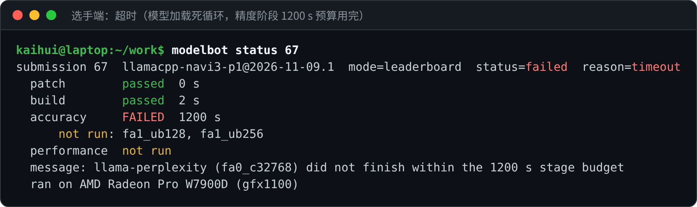

## 8. 排队、查询与取消

```bash
modelbot submit my.patch --mode test --no-wait   # 提交后立即返回
modelbot status <编号>                            # 查看状态；--wait 一直等到出结果，--json 输出原始数据
modelbot cancel <编号>                            # 取消：排队中的直接取消，在评测的会请求停止
```

每个选手同时只有一个提交在评测，其余的排队；评测卡都在忙时，新提交也要排队。下图里前面还有 4 个提交在等，所以新提交排在第 5 位。取消后状态变为 `cancelled`：

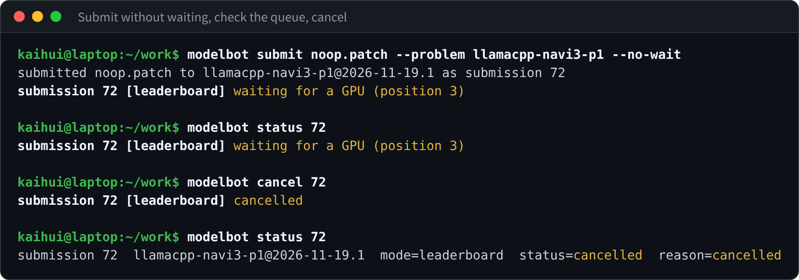

## 9. 历史提交、日志与补丁

```bash
modelbot list                      # 自己的提交（--problem 过滤，--limit 条数）
modelbot logs <编号>                # 列出该提交的日志文件
modelbot logs <编号> <日志名>        # 打印某个日志
modelbot patch <编号>               # 下载自己提交过的补丁（默认用提交时的文件名）
modelbot patch <编号> -o out.patch  # 指定保存路径
```

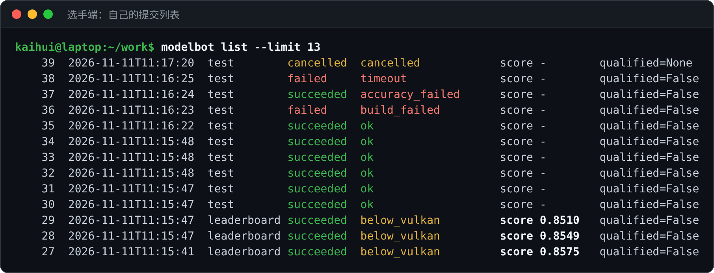

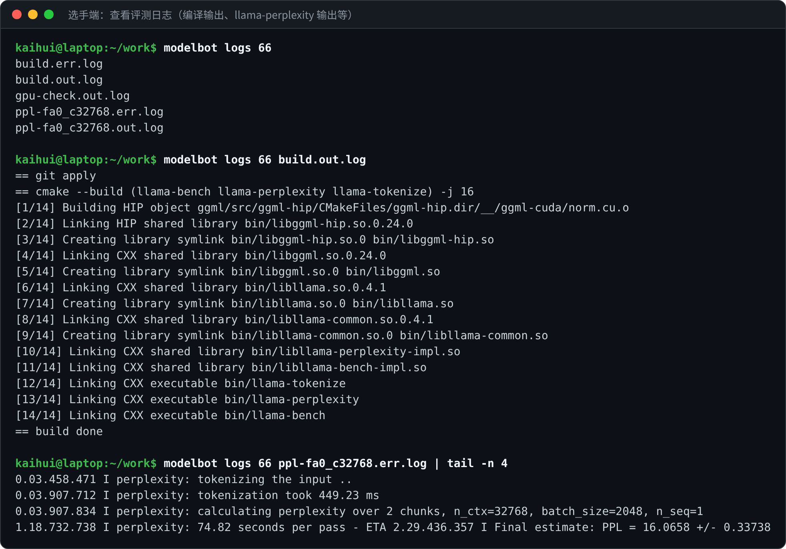

日志包括编译输出、GPU 检查、每组 `llama-perplexity` 和每条 `llama-bench` 的 stdout/stderr。为控制大小，每个日志只保留开头和结尾各一部分。

提交过的补丁在服务端保存，评测结束后也可以随时用 `modelbot patch` 取回。下图下载提交 #56 的 `noop.patch`，再用 `-o` 另存一份：

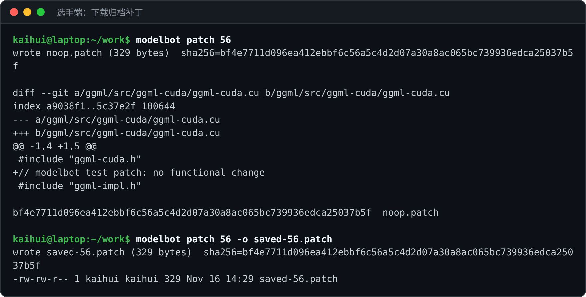

## 10. 排行榜

```bash
modelbot leaderboard               # 或 modelbot leaderboard --json
```

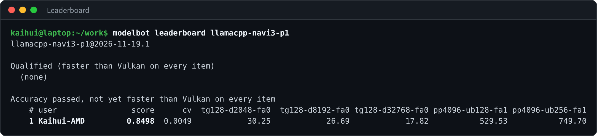

网页排行榜（只读，每分钟自动刷新）：https://rocm-challenge.amddev.ai/

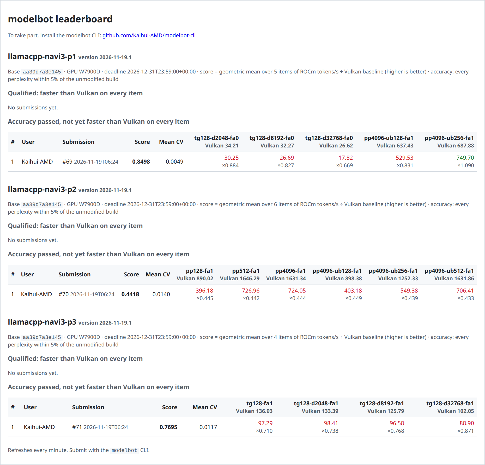

排名规则：

- 只统计 leaderboard 模式、当前题目版本的提交，每个选手取自己最好的一次；
- 上表 Qualified 是五项都快过 Vulkan 的选手，下表是精度通过但还没全部快过 Vulkan 的选手（已经上了上表的不会再出现在下表）；
- 按分数从高到低排；分数相同看平均 cv（越稳定越靠前），再相同看提交时间。

## 11. 状态和结果怎么看

`status` 表示评测流程走到哪里，`reason` 才是评测结论：

| status | 含义 |
|---|---|
| `queued` | 排队等 GPU（`position` 是队列中的位置） |
| `dispatching` | 已分到评测资源，等待开始 |
| `running` | 正在评测 |
| `succeeded` | 评测流程完整跑完，结论看 `reason` |
| `failed` | 补丁导致评测中止：编译失败、超时、崩溃、工具输出异常等 |
| `error` | 评测基础设施出了问题，与补丁无关。系统会先自动重试一次（重试期间是 `queued`），不计入提交次数限制；持续出现请联系组织者 |
| `cancelled` | 已取消 |

| reason | 含义 |
|---|---|
| `ok` | test 模式：编译和精度都通过；leaderboard 模式：五项都快过 Vulkan（qualified） |
| `below_vulkan` | 精度通过、性能已测，但至少有一项没快过 Vulkan，进入"精度通过"榜 |
| `accuracy_failed` | 至少一组 PPL 超出 ±5% |
| `build_failed` / `build_timeout` / `build_flags_changed` | 编译失败 / 编译超时 / 补丁改动了规定的编译选项 |
| `timeout` / `crash` / `output_invalid` / `bench_rows_mismatch` | 超时 / 工具崩溃 / 输出无法解析 / benchmark 输出的行和规定的五项对不上 |
| `forbidden_path` / `patch_apply_failed` / `binary_patch` / `empty_patch` / `patch_too_large` | 补丁不合格（通常在提交时就被拒绝，不会排队） |
| 其他（如 `run_not_found`、`no_result`、`attempt_timeout`） | 基础设施错误，见上表的 `error` |

CLI 退出码：0 表示通过（test 模式编译和精度都通过；leaderboard 模式性能也测完了），1 表示没通过，2 表示本地预检失败，3 表示 API 报错（例如超过提交次数限制、暂停提交、截止时间已过）。

提交限制：默认每人每小时 test 12 次、leaderboard 6 次，`error` 不计数；截止时间见 `modelbot problems`。

## 命令速查

| 命令 | 作用 |
|---|---|
| `modelbot register github [--no-browser]` | 用 GitHub 账号注册，保存 token |
| `modelbot reregister github [--no-browser]` | 给已注册的账号换一个新 token（旧 token 失效） |
| `modelbot whoami` | 查看当前 token 对应的账号 |
| `modelbot problems [NAME]` | 题目列表 / 详情 |
| `modelbot submit PATCH [--mode test\|leaderboard] [--no-wait] [--base DIR]` | 提交补丁（默认 leaderboard 模式，等待结果） |
| `modelbot status ID [--wait] [--json]` | 查看提交 |
| `modelbot list [--problem NAME] [--limit N]` | 自己的提交列表 |
| `modelbot logs ID [LOG]` | 日志列表 / 打印日志 |
| `modelbot patch ID [-o FILE]` | 下载自己提交过的补丁 |
| `modelbot cancel ID` | 取消提交 |
| `modelbot leaderboard [NAME] [--json]` | 排行榜 |
| `modelbot --version` | CLI 版本 |
