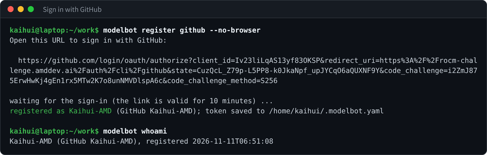
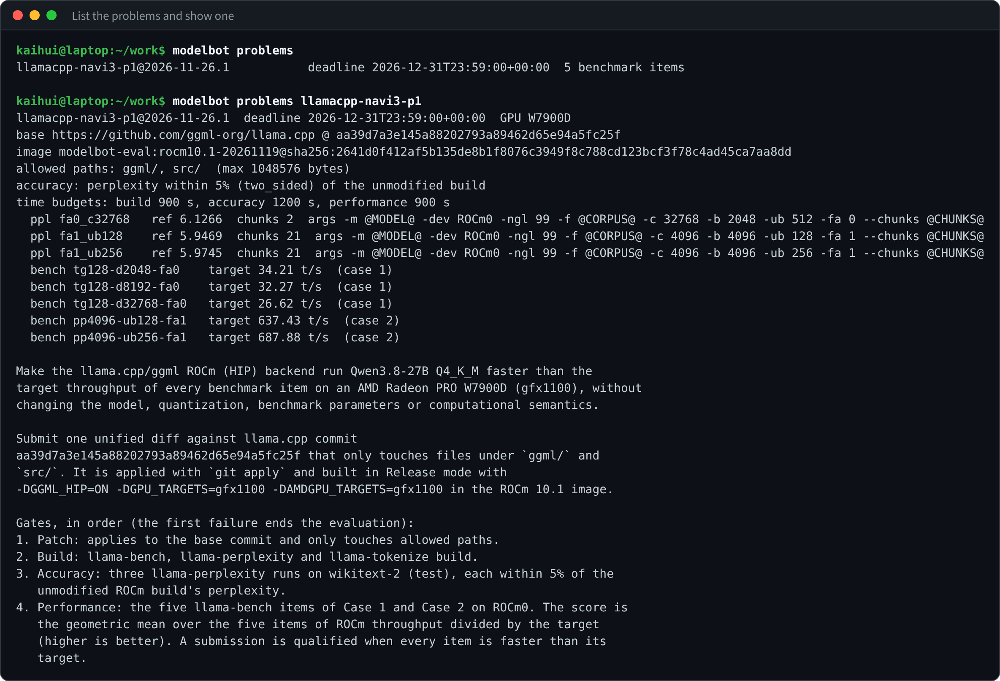
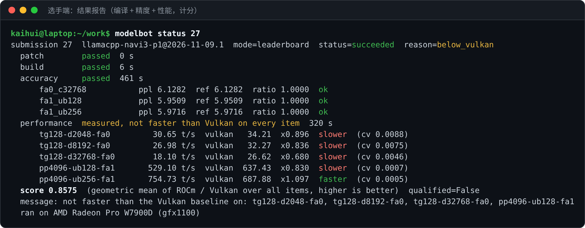

# modelbot-cli

English | [中文](README.zh-CN.md)

`modelbot` is the contestant CLI of the ROCm llama.cpp optimization challenge ([rocm-challenge.amddev.ai](https://rocm-challenge.amddev.ai/)): sign in with GitHub, submit patches against llama.cpp, and follow the results and the leaderboard.

| Problem | Model | Focus | Items | Statement |
|---|---|---|---|---|
| `llamacpp-navi3-p1` | Qwen3.8-27B Q4_K_M | long-context decode, small-ubatch prefill | 5 | [problem 1](https://github.com/Kaihui-AMD/modelbot-cli/blob/main/problem/problem1_EN_navi3.md) |
| `llamacpp-navi3-p2` | Qwen3-Next-80B-A3B-Instruct IQ2_XXS | prefill | 6 | [problem 2](https://github.com/Kaihui-AMD/modelbot-cli/blob/main/problem/problem2_EN_navi3.md) |
| `llamacpp-navi3-p3` | Kimi-Linear-48B-A3B-Instruct IQ4_XS | decode | 4 | [problem 3](https://github.com/Kaihui-AMD/modelbot-cli/blob/main/problem/problem3_EN_navi3.md) |

Each problem has its own leaderboard: https://rocm-challenge.amddev.ai/

## Quick start

```bash
pip install git+https://github.com/Kaihui-AMD/modelbot-cli
modelbot register github
modelbot problems
modelbot submit my.patch --problem llamacpp-navi3-p1
modelbot leaderboard llamacpp-navi3-p1
```

## How a submission is evaluated

A submission waits in the queue, then runs on one AMD Radeon PRO W7900D (ROCm 10.1) through four gates. The first failure ends the evaluation.

| Gate | Check | On failure |
|---|---|---|
| Patch | applies with `git apply --check` to the base commit `aa39d7a3`; touches only `ggml/` and `src/`; at most 1 MiB; no binaries, symlinks or submodules | rejected at submission, not queued |
| Build | incremental build of `llama-bench`, `llama-perplexity` and `llama-tokenize` (Release, `GGML_HIP=ON`, gfx1100) with the build options unchanged | `failed` / `build_failed` |
| Accuracy | two or three `llama-perplexity` runs on wikitext-2 (test) with fixed chunk counts, each within ±5% of the unmodified build (see the statement's Accuracy Validation) | `succeeded` / `accuracy_failed` |
| Performance | the `llama-bench` items of the statement | `succeeded` / `below_vulkan` |

- **Score**: the geometric mean over the items of ROCm throughput divided by the Vulkan baseline; higher is better. **Qualified**: every item is faster than its Vulkan baseline.
- An evaluation takes about 13 minutes for problem 1, 16 for problem 2 and 4 for problem 3, without the queue.
- You have at most one submission running at a time, across all problems; the others wait in the queue.
- Limit: 6 submissions per hour per problem. Infrastructure errors (`error`) do not count.

## 1. Install

Python 3.9 or later; depends on `requests` and `pyyaml`.

```bash
pip install git+https://github.com/Kaihui-AMD/modelbot-cli
pip install --upgrade git+https://github.com/Kaihui-AMD/modelbot-cli   # update later
```


## 2. Sign in with GitHub

```bash
modelbot register github                # first time
modelbot register github --no-browser   # only print the sign-in link
modelbot reregister github              # new token for your account (new machine, lost config)
modelbot whoami                         # account of the saved token
```

`register` opens GitHub's authorization page. After you authorize, the browser shows "Signed in to modelbot" and the CLI reports your account. The link works in any browser that can reach https://rocm-challenge.amddev.ai, for example when you sign in from a GPU server without a desktop:



- Your modelbot account is your GitHub account, with the same user name. modelbot asks for no GitHub permissions and keeps no GitHub token. After renaming your GitHub account, run `reregister` once.
- The API address and token are saved in `~/.modelbot.yaml` (mode 600) before the browser opens, and the token works once you finish the sign-in; Ctrl-C in the terminal does not stop that.
- `reregister` makes the previous token stop working. `register` on an account that already exists asks you to use `reregister`.
- `MODELBOT_CONFIG` selects another config file; `MODELBOT_API_URL` and `MODELBOT_TOKEN` override the saved values.

## 3. Problems

```bash
modelbot problems                      # open problems
modelbot problems llamacpp-navi3-p1    # one problem
```



The details show the base commit, the evaluation image (pinned by digest), the allowed paths, the time budget of each stage, every perplexity run with its reference and chunk count, and the Vulkan baseline of every benchmark item. All problems use the same base commit and image, so one patch can be submitted to several of them.

## 4. Make a patch

```bash
git clone https://github.com/ggml-org/llama.cpp && cd llama.cpp
git checkout aa39d7a3e145a88202793a89462d65e94a5fc25f
# edit files under ggml/ and src/ only
git diff > ../my.patch
```

Before uploading, the CLI checks the paths and the size, and with `--base <llama.cpp checkout>` also runs `git apply --check`; the server repeats the checks. To try the whole flow, submit [`examples/noop.patch`](https://github.com/Kaihui-AMD/modelbot-cli/blob/main/examples/noop.patch), which only adds a comment. It is a full, ranked evaluation and counts against the limit.

## 5. Submit and read the report

```bash
modelbot submit my.patch --problem llamacpp-navi3-p1
modelbot status <id>          # the same report again later
```

With several problems open, `submit` needs `--problem`. The CLI checks the status every 10 seconds, prints a line when it changes, and ends with the report: every gate with its duration, every perplexity run with its reference and ratio, every benchmark item with the ROCm throughput, the Vulkan baseline, their ratio and the coefficient of variation (cv) of the repetitions, then the score and the GPU.



The screenshot is the unmodified code on problem 1: score 0.8498, and only `pp4096-ub256-fa1` is faster than Vulkan.

## 6. When a submission fails

A build failure shows the compiler errors. An accuracy failure shows the perplexity run that is out of tolerance; the remaining runs and the benchmarks are skipped.


A stage that exceeds its time budget (`time budgets` in `modelbot problems <name>`) ends the evaluation with `timeout`, or `build_timeout` for the build.

## 7. Queue, status and cancel

```bash
modelbot submit my.patch --problem llamacpp-navi3-p1 --no-wait   # return right away
modelbot status <id>        # --wait: wait for the result; --json: raw data
modelbot cancel <id>        # a queued submission is cancelled, a running one is stopped
```

In the screenshot the user already has one submission running and two queued, so the new one is third in the queue:


## 8. Submissions and patches

```bash
modelbot list                    # your submissions; --problem to filter, --limit for more
modelbot patch <id> [-o FILE]    # download a patch you submitted
```

## 9. Leaderboard

```bash
modelbot leaderboard llamacpp-navi3-p1          # name the problem when several are open
modelbot leaderboard llamacpp-navi3-p1 --json   # raw data
```


The web leaderboard (read-only, refreshed every minute) has one section per problem: https://rocm-challenge.amddev.ai/


- Every problem is ranked separately, over its current version; each user's best submission counts.
- **Qualified** lists the users faster than Vulkan on every item. **Accuracy passed** lists the other users whose accuracy passed; nobody is listed in both.
- Order: score, then the lower mean cv, then the earlier submission.
- Submissions the organizers disqualify do not count, so your next best submission takes their place. `modelbot list` marks them `disqualified` and `modelbot status` shows the reason.

## Reference

`status` tells where the evaluation is; `reason` is the verdict.

| status | Meaning |
|---|---|
| `queued` | waiting for a GPU; `position` is the place in the queue |
| `dispatching` | assigned to a GPU, about to start |
| `running` | being evaluated |
| `succeeded` | the evaluation completed; see `reason` |
| `failed` | the patch stopped the evaluation: build failure, timeout, crash, unusable tool output |
| `error` | an infrastructure problem, not your patch: retried once automatically (shown as `queued` meanwhile) and not counted against the limit; tell the organizers if it persists |
| `cancelled` | cancelled |

| reason | Meaning |
|---|---|
| `ok` | accuracy passed and every item is faster than Vulkan (qualified) |
| `below_vulkan` | accuracy passed and the benchmarks ran, but at least one item is slower than Vulkan |
| `accuracy_failed` | a perplexity run is outside ±5% |
| `build_failed`, `build_timeout`, `build_flags_changed` | the build failed, timed out, or the patch changed the required build options |
| `timeout`, `crash`, `output_invalid`, `bench_rows_mismatch` | a stage timed out, a tool crashed, its output could not be parsed, or the benchmark rows do not match the items |
| `forbidden_path`, `patch_apply_failed`, `binary_patch`, `empty_patch`, `patch_too_large` | invalid patch, normally rejected at submission |
| others, such as `run_not_found`, `no_result`, `attempt_timeout` | infrastructure error, see `error` |

Exit codes: 0 when accuracy passed and the benchmarks ran (faster than Vulkan or not), 1 when the submission did not pass, 2 when the local pre-check failed, 3 for API errors such as the rate limit, paused submissions or a passed deadline. The deadlines are shown by `modelbot problems`.

| Command | Purpose |
|---|---|
| `modelbot register github [--no-browser]` | sign in with GitHub and save the token |
| `modelbot reregister github [--no-browser]` | new token for your account; the old one stops working |
| `modelbot whoami` | account of the saved token |
| `modelbot problems [NAME]` | open problems, or one problem |
| `modelbot submit PATCH --problem NAME [--no-wait] [--base DIR]` | submit a patch and wait for the result |
| `modelbot status ID [--wait] [--json]` | one submission |
| `modelbot list [--problem NAME] [--limit N]` | your submissions |
| `modelbot patch ID [-o FILE]` | download a submitted patch |
| `modelbot cancel ID` | cancel a submission |
| `modelbot leaderboard [NAME] [--json]` | leaderboard; name the problem when several are open |
| `modelbot --version` | CLI version |
