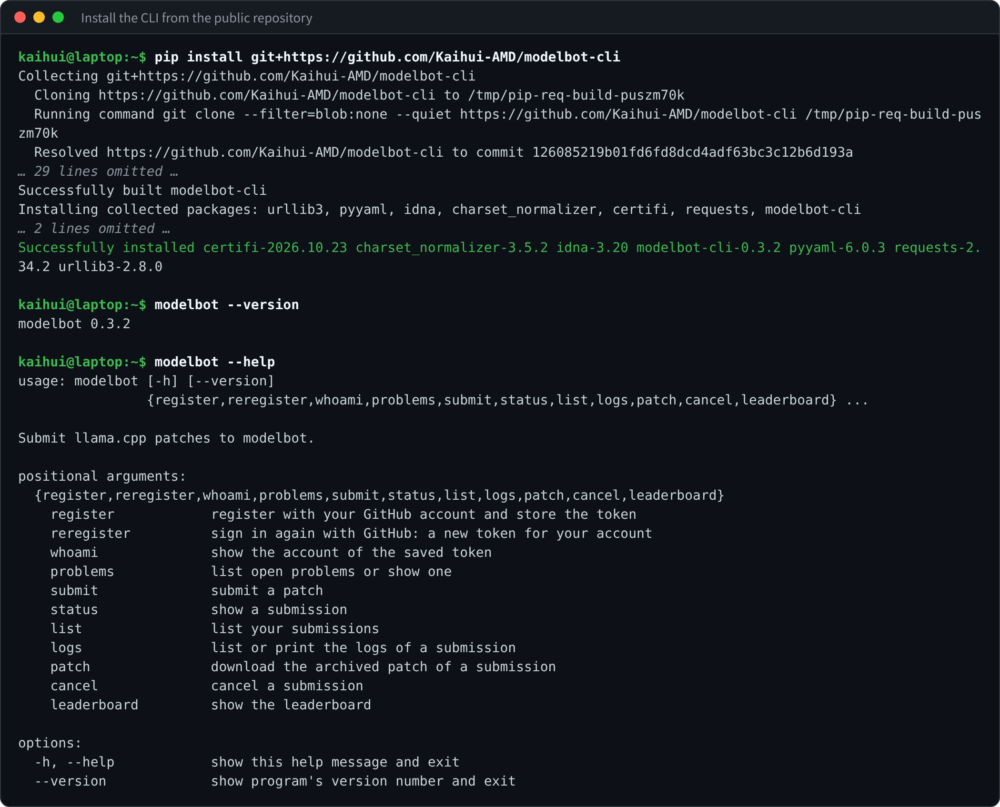
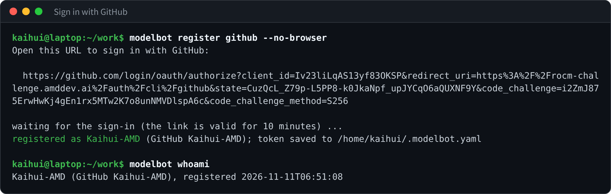
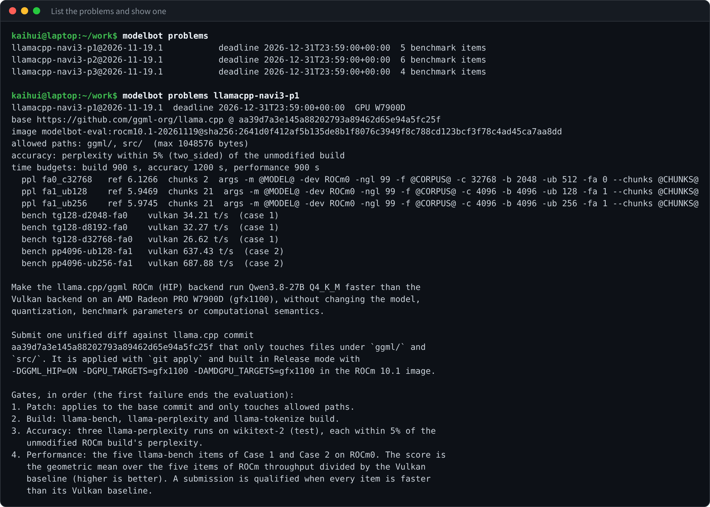
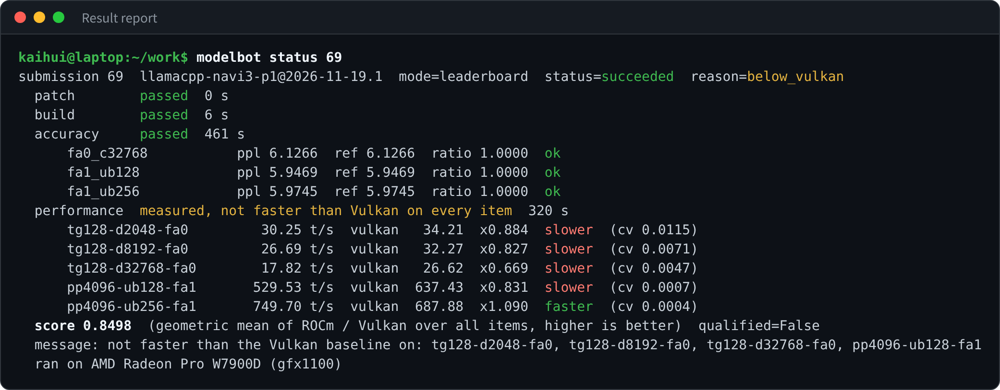
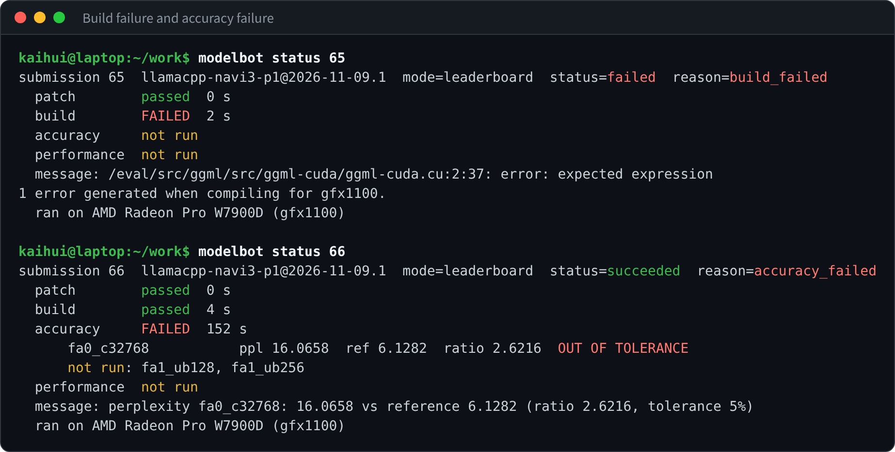
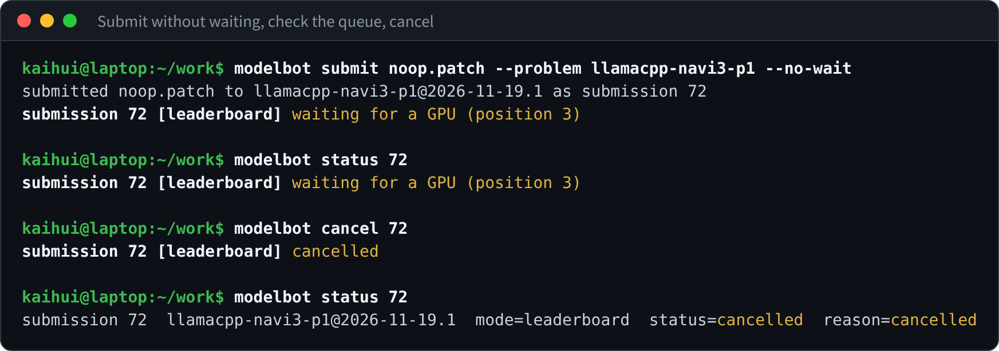
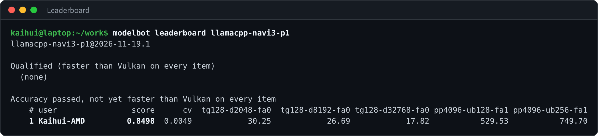
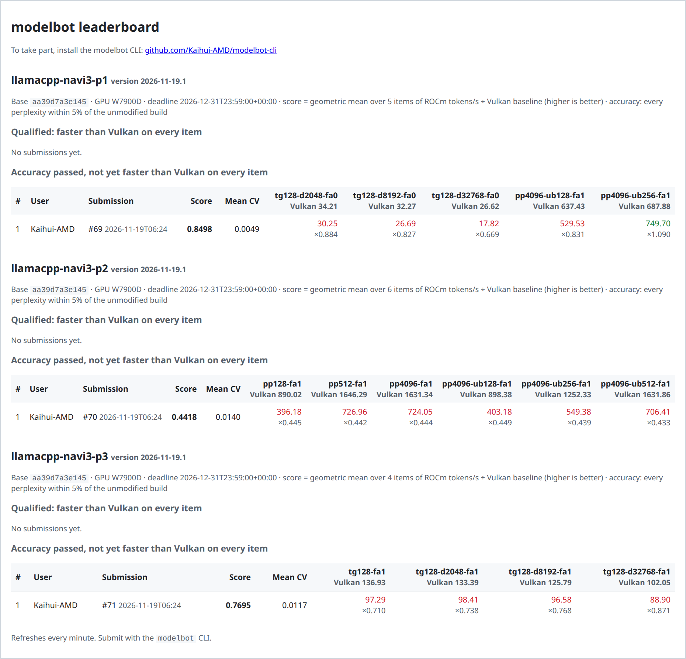

# modelbot-cli

[English](README.md) | 中文

`modelbot` 是 ROCm llama.cpp 优化赛（[rocm-challenge.amddev.ai](https://rocm-challenge.amddev.ai/)）的选手命令行工具：用 GitHub 账号登录，提交针对 llama.cpp 的补丁，查看评测结果和排行榜。

| 题目 | 模型 | 侧重 | 项数 | 题面 |
|---|---|---|---|---|
| `llamacpp-navi3-p1` | Qwen3.8-27B Q4_K_M | 长上下文 decode、小 ubatch prefill | 5 | [第 1 题](https://github.com/Kaihui-AMD/modelbot-cli/blob/main/problem/problem1_EN_navi3.md) |
| `llamacpp-navi3-p2` | Qwen3-Next-80B-A3B-Instruct IQ2_XXS | prefill | 6 | [第 2 题](https://github.com/Kaihui-AMD/modelbot-cli/blob/main/problem/problem2_EN_navi3.md) |
| `llamacpp-navi3-p3` | Kimi-Linear-48B-A3B-Instruct IQ4_XS | decode | 4 | [第 3 题](https://github.com/Kaihui-AMD/modelbot-cli/blob/main/problem/problem3_EN_navi3.md) |

每道题单独排名，网页排行榜：https://rocm-challenge.amddev.ai/

## 快速开始

```bash
pip install git+https://github.com/Kaihui-AMD/modelbot-cli
modelbot register github
modelbot problems
modelbot submit my.patch --problem llamacpp-navi3-p1
modelbot leaderboard llamacpp-navi3-p1
```

## 评测流程

提交先进入队列，轮到时在一张 AMD Radeon PRO W7900D（ROCm 10.1）上依次经过四道关，任何一关不通过就结束。

| 关卡 | 检查内容 | 不通过时 |
|---|---|---|
| 补丁 | `git apply --check` 能打到基准 commit `aa39d7a3` 上；只改 `ggml/` 和 `src/`；不超过 1 MiB；不含二进制、符号链接或子模块 | 提交时直接拒绝，不排队 |
| 编译 | 增量编译 `llama-bench`、`llama-perplexity`、`llama-tokenize`（Release，`GGML_HIP=ON`，gfx1100），编译选项不能改 | `failed` / `build_failed` |
| 精度 | 两到三组 `llama-perplexity`（wikitext-2 test，chunk 数固定），每组 PPL 与未修改版本的偏差在 ±5% 以内（见题面的 Accuracy Validation） | `succeeded` / `accuracy_failed` |
| 性能 | 题面列出的各项 `llama-bench` | `succeeded` / `below_vulkan` |

- **分数**：各项 ROCm 吞吐与 Vulkan 基线之比的几何平均，越高越好。**qualified**：每一项都快过 Vulkan。
- 不算排队，一次评测第 1 题约 13 分钟、第 2 题约 16 分钟、第 3 题约 4 分钟。
- 每人同时只有一个提交在评测（不论哪道题），其余的排队。
- 提交限制：每道题每人每小时 6 次，基础设施错误（`error`）不计数。

## 1. 安装

需要 Python 3.9 及以上，依赖 `requests` 和 `pyyaml`。

```bash
pip install git+https://github.com/Kaihui-AMD/modelbot-cli
pip install --upgrade git+https://github.com/Kaihui-AMD/modelbot-cli   # 以后升级
```



## 2. 用 GitHub 登录

```bash
modelbot register github                # 第一次使用
modelbot register github --no-browser   # 只打印授权链接
modelbot reregister github              # 给自己的账号换一个新 token（换电脑、丢了配置）
modelbot whoami                         # 查看当前 token 对应的账号
```

`register` 会打开 GitHub 的授权页。授权后，浏览器显示 "Signed in to modelbot"，CLI 随即显示登录的账号。授权链接可以在任何一台能访问 https://rocm-challenge.amddev.ai 的电脑上打开，比如在没有图形界面的 GPU 服务器上登录：



- modelbot 账号就是你的 GitHub 账号，用户名相同。modelbot 不申请任何 GitHub 权限，也不保存 GitHub 的 token。GitHub 改名后 `reregister` 一次即可。
- API 地址和 token 在打开浏览器之前就写进 `~/.modelbot.yaml`（权限 600），在网页上完成授权后生效；中途在终端按 Ctrl-C 也不影响。
- `reregister` 之后旧 token 立即失效。已经登录过的账号再 `register` 会提示改用 `reregister`。
- `MODELBOT_CONFIG` 可以指定别的配置文件，`MODELBOT_API_URL`、`MODELBOT_TOKEN` 可以覆盖配置里的值。

## 3. 查看题目

```bash
modelbot problems                      # 开放的题目
modelbot problems llamacpp-navi3-p1    # 某道题的详情
```



详情里有基准 commit、评测镜像（按 digest 固定）、允许修改的路径、各阶段的时间预算、每组 PPL 的参考值和 chunk 数，以及每项 benchmark 的 Vulkan 基线。三道题用同一个基准 commit 和评测镜像，同一个补丁可以分别提交到几道题。

## 4. 制作补丁

```bash
git clone https://github.com/ggml-org/llama.cpp && cd llama.cpp
git checkout aa39d7a3e145a88202793a89462d65e94a5fc25f
# 只修改 ggml/ 和 src/ 下的文件
git diff > ../my.patch
```

上传前 CLI 会在本地检查路径和大小，加上 `--base <llama.cpp 目录>` 时还会跑一次 `git apply --check`；服务端会再检查一遍。想先走通流程，可以提交 [`examples/noop.patch`](https://github.com/Kaihui-AMD/modelbot-cli/blob/main/examples/noop.patch)，它只加了一行注释。它和正式提交一样完整评测、参与排名，也占一次提交次数。

## 5. 提交和结果报告

```bash
modelbot submit my.patch --problem llamacpp-navi3-p1
modelbot status <编号>        # 之后随时再看这份报告
```

开放了多道题时，`submit` 必须用 `--problem` 指定题目。CLI 每 10 秒查询一次状态，有变化就打印一行，最后打印结果报告：每道关的结果和耗时，每组 PPL 的实测值、参考值和比值，每项 benchmark 的 ROCm 吞吐、Vulkan 基线、两者之比和多次重复的变异系数（cv），最后是分数和评测用的 GPU。



截图是第 1 题未修改的代码：分数 0.8498，只有 `pp4096-ub256-fa1` 快过 Vulkan。

## 6. 没通过时会看到什么

编译失败时显示编译器报错。精度超差时显示超差的那组 PPL，后面几组 PPL 和性能测试都不再跑。



某个阶段超过时间预算（见 `modelbot problems <题目>` 里的 `time budgets`）时评测结束，结果是 `timeout`，编译阶段是 `build_timeout`。

## 7. 排队、查询与取消

```bash
modelbot submit my.patch --problem llamacpp-navi3-p1 --no-wait   # 提交后立即返回
modelbot status <编号>      # --wait 一直等到出结果，--json 输出原始数据
modelbot cancel <编号>      # 排队中的直接取消，在评测的会停止
```

截图里这个选手已经有一个提交在评测、两个在排队，所以新提交排在第 3 位：



## 8. 历史提交、日志与补丁

```bash
modelbot list                    # 自己的提交；--problem 过滤，--limit 显示更多
modelbot logs <编号>             # 列出该提交的日志文件
modelbot logs <编号> <日志名>     # 打印某个日志：编译输出、GPU 检查、每组 llama-perplexity 和每条 llama-bench
modelbot patch <编号> [-o 文件]   # 下载自己提交过的补丁
```

较长的日志只保留开头和结尾。

## 9. 排行榜

```bash
modelbot leaderboard llamacpp-navi3-p1          # 开放了多道题时要写题目名
modelbot leaderboard llamacpp-navi3-p1 --json   # 原始数据
```



网页排行榜（只读，每分钟自动刷新）每道题一节：https://rocm-challenge.amddev.ai/



- 每道题单独排名，只统计该题当前版本的提交，每个选手取自己最好的一次。
- **Qualified** 是每一项都快过 Vulkan 的选手，**Accuracy passed** 是精度通过的其他选手，同一个人不会同时出现在两张表里。
- 先按分数排，分数相同看平均 cv（越小越靠前），再相同看提交时间。
- 被组织者判定违规的提交不参与排名，你次好的那条成绩会顶上来。`modelbot list` 会在这条提交后面标 `disqualified`，`modelbot status` 会写明原因。

## 参考

`status` 表示评测走到哪一步，`reason` 才是结论。

| status | 含义 |
|---|---|
| `queued` | 排队等 GPU，`position` 是队列中的位置 |
| `dispatching` | 已分到 GPU，马上开始 |
| `running` | 正在评测 |
| `succeeded` | 评测完整跑完，结论看 `reason` |
| `failed` | 补丁导致评测中止：编译失败、超时、崩溃、工具输出异常 |
| `error` | 基础设施出了问题，与补丁无关：自动重试一次（重试期间显示 `queued`），不计入提交次数；持续出现请联系组织者 |
| `cancelled` | 已取消 |

| reason | 含义 |
|---|---|
| `ok` | 精度通过，每一项都快过 Vulkan（qualified） |
| `below_vulkan` | 精度通过、性能已测，但至少有一项没快过 Vulkan |
| `accuracy_failed` | 有一组 PPL 超出 ±5% |
| `build_failed`、`build_timeout`、`build_flags_changed` | 编译失败、编译超时、补丁改动了规定的编译选项 |
| `timeout`、`crash`、`output_invalid`、`bench_rows_mismatch` | 阶段超时、工具崩溃、输出无法解析、benchmark 输出的行和规定的各项对不上 |
| `forbidden_path`、`patch_apply_failed`、`binary_patch`、`empty_patch`、`patch_too_large` | 补丁不合格，通常在提交时就被拒绝 |
| 其他，如 `run_not_found`、`no_result`、`attempt_timeout` | 基础设施错误，见上表的 `error` |

退出码：0 表示精度通过、性能已测（不论是否快过 Vulkan），1 表示没通过，2 表示本地预检失败，3 表示 API 报错，例如超过提交次数、暂停提交、截止时间已过。截止时间见 `modelbot problems`。

| 命令 | 作用 |
|---|---|
| `modelbot register github [--no-browser]` | 用 GitHub 登录，保存 token |
| `modelbot reregister github [--no-browser]` | 给自己的账号换新 token，旧 token 失效 |
| `modelbot whoami` | 当前 token 对应的账号 |
| `modelbot problems [NAME]` | 题目列表，或某道题的详情 |
| `modelbot submit PATCH --problem NAME [--no-wait] [--base DIR]` | 提交补丁并等待结果 |
| `modelbot status ID [--wait] [--json]` | 查看一条提交 |
| `modelbot list [--problem NAME] [--limit N]` | 自己的提交列表 |
| `modelbot logs ID [LOG]` | 列出或打印日志 |
| `modelbot patch ID [-o FILE]` | 下载提交过的补丁 |
| `modelbot cancel ID` | 取消提交 |
| `modelbot leaderboard [NAME] [--json]` | 排行榜；开放多道题时要写题目名 |
| `modelbot --version` | CLI 版本 |
